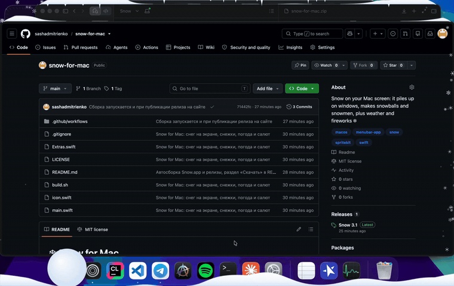

# ❄︎ Snow for Mac



Snow falls across your Mac's screen, piles up on top of your windows and slides off when you shake them. Sweep it away with the cursor, roll snowballs, build snowmen, and have a snowball fight.

[Русская версия ниже](#-снег-для-mac)

## Features

- **Snow that lands on windows.** Drifts form along the top edge of every window, follow the rounded corners, and calve off the edges once they get too heavy. Drag a window sharply and everything on it falls off.
- **Snowballs and snowmen.** Hover over snow until a ring appears around the cursor, then press and hold to make a snowball. Roll it through the snow to make it bigger. Fling it to throw it, or let go gently to set it down. Stack two or three balls to get a snowman whose eyes follow your cursor.
- **Snowball fight.** Snowballs fly in from the edges of the screen at your cursor. Click them to knock them away. The score shows next to ❄︎ in the menu bar.
- **Weather.** Pick snow, rain, falling leaves or cherry blossoms. You can also switch on **real weather**: enter your city and the app follows the actual conditions outside (snow, rain, wind) via [Open-Meteo](https://open-meteo.com). When it's above freezing, the snow melts.
- **Icicles** grow under snowy window edges. Click one to snap it off.
- **Frost** creeps in from the screen edges while you're away and melts when you come back.
- **New Year.** A blinking garland hangs on the active window, a countdown runs at 23:59:50 on December 31, and fireworks start at midnight. You can also launch fireworks any time: there are 9 kinds of bursts.
- **Sound** for crunching snow, snowball hits, shattering icicles and fireworks. All sounds are synthesized in code, so there are no audio files.
- **Light on resources.** Rendering runs on the GPU (SpriteKit). Drawing stops entirely when nothing on screen is moving, and the app pauses when the screen sleeps or locks. An energy-saving mode (30 fps) is available.

## Hotkeys

These work from any app.

| Keys | Action |
|---|---|
| ⌃⌥⌘ S | Pause / resume |
| ⌃⌥⌘ H | Hide / show everything (handy for screen sharing) |
| ⌃⌥⌘ C | Clear all snow |
| ⌃⌥⌘ ↑ / ↓ | More / less snow |
| ⌃⌥⌘ W | Next weather |
| ⌃⌥⌘ B | Snowball fight |
| ⌃⌥⌘ F | Fireworks |

## Download

Grab `Snow.zip` from [Releases](https://github.com/sashadmitrienko/snow-for-mac/releases/latest), unzip it and move `Snow.app` to Applications.

The app isn't signed with an Apple developer certificate, so macOS will block it the first time you open it. To allow it:

- open **System Settings → Privacy & Security**, scroll down and click **Open Anyway** next to the message about Snow; or
- run this in Terminal: `xattr -dr com.apple.quarantine /Applications/Snow.app`

## Build from source

You need macOS 12 or later and the Xcode Command Line Tools (`xcode-select --install`).

```bash
git clone https://github.com/sashadmitrienko/snow-for-mac.git
cd snow-for-mac
bash build.sh
```

This produces `Snow.app` for both Apple Silicon and Intel. Drag it into Applications and open it. Everything is controlled from the ❄︎ icon in the menu bar.

## Privacy

The app asks for no system permissions. It reads only the position and size of windows (not their contents), the cursor position and how long you've been idle. The network is used only by the optional real-weather mode: your city name goes to the Open-Meteo geocoding service, and then only the city's coordinates are sent, once every 15 minutes.

## License

[MIT](LICENSE)

---

# ❄︎ Снег для Mac

На экране Mac идёт снег: он копится на окнах, слетает с них, если окно дёрнуть, сметается курсором. Из него можно лепить снежки, складывать снеговиков и устраивать снежную битву.

## Возможности

- **Снег ложится на окна.** Сугробы растут вдоль верхнего края каждого окна, учитывают скруглённые углы и обваливаются с краёв, когда становятся тяжёлыми. Если резко дёрнуть окно, всё, что на нём лежит, слетит.
- **Снежки и снеговики.** Наведи курсор на снег, пока вокруг курсора не появится колечко, зажми кнопку мыши, и получится снежок. Если катать его по сугробу, он растёт. Отпусти с размахом, и снежок полетит, а если спокойно, то ляжет. Два-три кома друг на друге превращаются в снеговика, который следит глазами за курсором.
- **Снежная битва.** Из-за краёв экрана в курсор летят снежки. Кликай по ним, чтобы отбить. Счёт виден рядом с ❄︎ в строке меню.
- **Погода.** Можно выбрать снег, дождь, листопад или сакуру. А можно включить **реальную погоду**: указываешь город, и на экране идёт то же, что за окном (снег, дождь, ветер). Данные берутся с [Open-Meteo](https://open-meteo.com). В плюс снег тает.
- **Сосульки** растут под заснеженными краями окон. Кликни по сосульке, чтобы её отломить.
- **Иней** нарастает по краям экрана, пока ты не трогаешь Мак, и тает, когда возвращаешься.
- **Новый год.** На активном окне мигает гирлянда, 31 декабря в 23:59:50 идёт отсчёт, а в полночь начинается салют. Салют можно запустить и в любой момент: в нём 9 видов залпов.
- **Звук.** Хруст снега, шлепки снежков, звон сосулек и салют. Все звуки синтезируются в коде, аудиофайлов нет.
- **Бережёт ресурсы.** Рисует видеокарта (SpriteKit). Если на экране ничего не движется, отрисовка полностью останавливается, а при сне или блокировке экрана приложение встаёт на паузу. Есть режим экономии энергии (30 кадров в секунду).

## Горячие клавиши

Работают из любой программы.

| Клавиши | Что делает |
|---|---|
| ⌃⌥⌘ S | Пауза / продолжить |
| ⌃⌥⌘ H | Скрыть / показать всё (удобно для созвонов) |
| ⌃⌥⌘ C | Убрать весь снег |
| ⌃⌥⌘ ↑ / ↓ | Сильнее / слабее |
| ⌃⌥⌘ W | Следующая погода |
| ⌃⌥⌘ B | Снежная битва |
| ⌃⌥⌘ F | Салют |

## Скачать

Скачай `Snow.zip` в [Releases](https://github.com/sashadmitrienko/snow-for-mac/releases/latest), распакуй и перетащи `Snow.app` в «Программы».

Приложение не подписано сертификатом разработчика Apple, поэтому при первом запуске macOS его заблокирует. Чтобы разрешить запуск:

- открой **Системные настройки → Конфиденциальность и безопасность**, пролистай вниз и нажми **«Всё равно открыть»** рядом с сообщением про Snow; или
- выполни в Терминале: `xattr -dr com.apple.quarantine /Applications/Snow.app`

## Сборка из исходников

Нужны macOS 12 или новее и Command Line Tools (`xcode-select --install`).

```bash
git clone https://github.com/sashadmitrienko/snow-for-mac.git
cd snow-for-mac
bash build.sh
```

Получится `Snow.app` для Apple Silicon и Intel. Перетащи его в «Программы» и открой. Всё управление — через значок ❄︎ в строке меню.

## Приватность

Приложение не просит никаких системных разрешений. Оно знает только положение и размер окон (но не их содержимое), положение курсора и сколько времени ты не трогаешь компьютер. В сеть ходит только режим реальной погоды: название города один раз отправляется в геокодер Open-Meteo, а потом раз в 15 минут отправляются только координаты города.

## Лицензия

[MIT](LICENSE)
